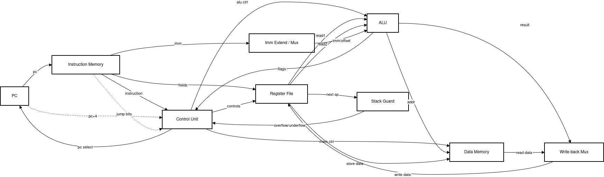

# Custom MIPS Processor with Hardware Stack Overflow Protection

A modified **32-bit single-cycle MIPS-lite processor** in Verilog HDL. It has a **custom instruction set** (opcodes derived from the student ID) and a dedicated **Stack Guard** unit that detects stack overflow and underflow in hardware and blocks the faulting instruction's writes.



## Project Overview

| | |
| --- | --- |
| **Course** | CENG 311 – Computer Architecture (Fall 2025), IYTE |
| **Architecture** | 32-bit single-cycle MIPS-lite |
| **Language** | Verilog HDL |
| **Simulation** | ModelSim / QuestaSim |
| **Specification** | [`docs/ceng311_pa3.pdf`](docs/ceng311_pa3.pdf) |

## Key Features

1. **Custom ISA**: 8-bit opcodes (102–110) and a compact encoding with 16 registers (4-bit register fields).
2. **Hardware stack protection**: the `stack_guard` module checks every instruction that touches `$sp`:
   - **Overflow**: a push beyond the 2-word stack limit (`$sp < -8`, or an effective address above the stack region).
   - **Underflow**: a pop from an empty stack (`$sp > 0`, or an effective address below the stack region).
   - **Interlock**: when either flag is raised, `RegWrite`, `MemWrite` and `MemRead` are gated off, so the faulting instruction has no architectural effect.
3. **Stack-relative addressing**: loads and stores based on `$sp` are mapped into physical memory at `$spba + $sp + offset` by the ALU.
4. **Debug outputs**: PC, instruction, ALU result and overflow/underflow flags are exposed for the waveform viewer.

## Instruction Formats

| Type | [31:24] | [23:20] | [19:16] | [15:12] | [11:6] | [5:0] |
| --- | --- | --- | --- | --- | --- | --- |
| **R** | opcode | rs | rt | rd | shamt | funct |
| **I** | opcode | rs | rt | imm[15:0] | | |
| **B-I** | opcode | rs | – | compare imm[15:8] | branch offset [7:0] | |
| **J** | opcode | address [23:0] | | | | |

## Instruction Set

| Instruction | Opcode | Funct | Type | Operation |
| --- | --- | --- | --- | --- |
| `sll` | 102 | 1 | R | `rd = rs << shamt` |
| `move` | 102 | 2 | R | `rd = rs` |
| `nand` | 102 | 3 | R | `rd = ~(rs & rt)` |
| `or` | 102 | 4 | R | `rd = rs \| rt` |
| `add` | 102 | 5 | R | `rd = rs + rt` |
| `lw` | 103 | – | I | `rt = MEM[rs + imm]` |
| `sw` | 104 | – | I | `MEM[rs + imm] = rt` |
| `beq` | 105 | – | I | `if (rs == rt) PC = PC + 4 + imm·4` |
| `blt` | 106 | – | I | `if (rs < rt) PC = PC + 4 + imm·4` |
| `subi` | 107 | – | I | `rt = rs − imm` |
| `addi` | 108 | – | I | `rt = rs + imm` |
| `beqi` | 109 | – | B-I | `if (rs == imm[15:8]) PC = PC + 4 + offset·4` |
| `j` | 110 | – | J | `PC = {PC+4[31:28], address, 00}` |

## Register Conventions

| # | Name | Initial value | # | Name | Initial value |
| --- | --- | --- | --- | --- | --- |
| R0 | `$0` | 0 | R8 | `$t2` | 4 |
| R1 | `$s0` | 2 | R9 | `$a0` | 0 |
| R2 | `$s1` | 3 | R10 | `$a1` | 0 |
| R3 | `$s2` | 4 | R11 | `$v0` | 0 |
| R4 | `$s3` | 2 | R12 | **`$spba`**: stack base address | 40 |
| R5 | `$s4` | 3 | R13 | **`$spl`**: stack limit (words) | 2 |
| R6 | `$t0` | 6 | R14 | **`$sp`**: stack pointer | 0 (empty) |
| R7 | `$t1` | 9 | R15 | `$ra` | 0 |

The stack occupies physical addresses **32–39** (2 words below `$spba = 40`). `$sp` is relative to the base: `0` means empty, `-4` means one word pushed, `-8` means full.

## Repository Structure

```
.
├── coding/
│   ├── defines.v              # Opcodes, funct codes, ALU control lines, stack constants
│   ├── processor.v            # Top-level single-cycle datapath + next-PC logic
│   ├── control_unit.v         # Main decoder / control signal generation
│   ├── alu.v                  # ALU (add, sub, and, or, nand, sll, move, slt) + SP addressing
│   ├── stack_guard.v          # Overflow / underflow detection
│   ├── register_file.v        # 16 × 32-bit registers, async read, sync write
│   ├── instruction_memory.v   # 64-byte big-endian instruction ROM
│   ├── data_memory.v          # 64-byte big-endian data RAM
│   └── tb_processor.v         # Testbench (clock, reset, VCD dump)
├── simulation/
│   ├── instruction_memory1-5.dat   # Test programs (binary, commented)
│   ├── register_file.dat           # Initial register values
│   └── data_memory.dat             # Initial data memory
├── docs/ceng311_pa3.pdf       # Assignment specification
└── processor_design.drawio.png
```

## Test Programs

| File | What it tests |
| --- | --- |
| `instruction_memory1.dat` | `lw`, `add`, `beqi`, `sw`, `blt`, `j`, `addi`: a load/compare loop |
| `instruction_memory2.dat` | ALU operations: `addi`, `sll`, `nand`, `subi` |
| `instruction_memory3.dat` | Branching with `blt`, plus `move` and `or` |
| `instruction_memory4.dat` | Stack pushes (`addi $sp`, `sw`) followed by an out-of-range `$sp` access that trips the **Stack Guard** |
| `instruction_memory5.dat` | Popping from an empty stack (`addi $sp, $sp, 4`), which triggers **underflow** detection |

To choose a program, change the file name in `coding/instruction_memory.v`:

```verilog
$readmemb("simulation/instruction_memory5.dat", memory);
```

## Running the Simulation

The `.dat` paths are relative, so run the simulator from the **repository root**.

```tcl
vlib work
vlog +incdir+coding coding/*.v
vsim work.tb_processor
add wave -r /*
run -all
```

The testbench resets the processor, runs for 2 µs and writes a `processor_sim.vcd` waveform. Watch `debug_pc`, `debug_instruction`, `debug_alu_result`, `debug_overflow` and `debug_underflow`.

## Author

Mustafa Mert İnce
